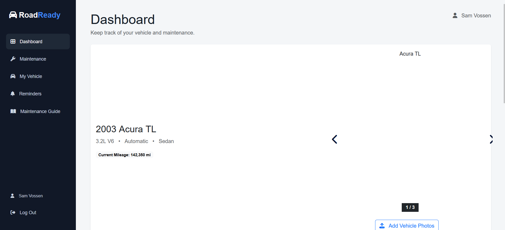
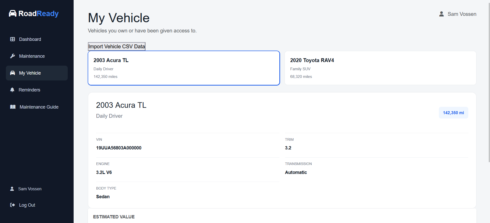
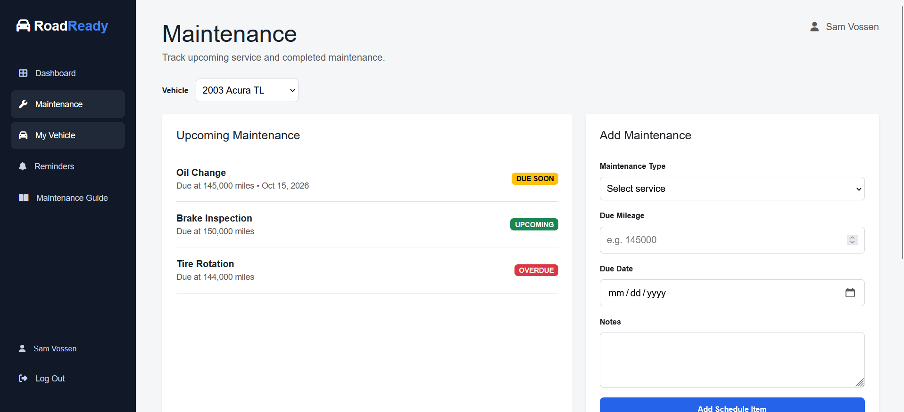
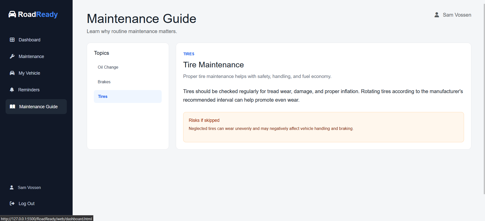

# RoadReady

RoadReady is a vehicle maintenance dashboard that helps users keep track of their vehicles, maintenance schedules, and service history.

It is designed for vehicle owners who want a simple way to see what maintenance is coming up and keep track of work that has already been completed.

## Tech Used

- HTML
- CSS
- JavaScript
- MySQL
- VS Code Live Server

## Running RoadReady

Currently, RoadReady runs as a frontend website.

1. Download or clone the project.
2. Open the project in VS Code.
3. Install the **Live Server** extension if you do not already have it.
4. Open `index.html`.
5. Right-click the file and select **Open with Live Server**.

The website will open in your browser.

## Current Features

RoadReady currently includes:

- Dashboard
- Multiple vehicle support
- Vehicle selection
- Vehicle information
- Upcoming maintenance
- Maintenance history
- Maintenance status
- Maintenance guide
- Shared navigation and footer
- Temporary frontend data using JavaScript

JavaScript is currently used to load vehicle data, select vehicles, display maintenance information, and manage temporary user selections with `localStorage`.

## Screenshots

### Dashboard



### My Vehicle



### Maintenance



### Maintenance Guide



## Project Structure

```text
RoadReady/
├── index.html
├── images/
├── includes/
│   ├── styles.css
│   ├── app.js
│   ├── navbar.js
│   └── footer.js
├── js/
│   ├── data.js
│   ├── dashboard.js
│   ├── vehicle.js
│   ├── maintenance.js
│   └── maintenance-guide.js
└── web/
    ├── dashboard.html
    ├── vehicle.html
    ├── maintenance.html
    └── maintenance-guide.html
```

## Current Limitations

The current version is still frontend-only.

- Authentication is not implemented.
- The frontend does not currently connect to MySQL.
- Database changes cannot currently be made through the website.
- Vehicle and maintenance data is temporary.
- Reminders are not fully implemented.
- Some planned features are not available yet.

## Future Plans

Future development will include:

- Node.js backend
- REST API
- MySQL database connection
- User authentication
- Adding and completing maintenance records
- Automated reminders
- Vehicle photos
- VIN lookup
- Recall information
- Vehicle valuation
- Data imports
