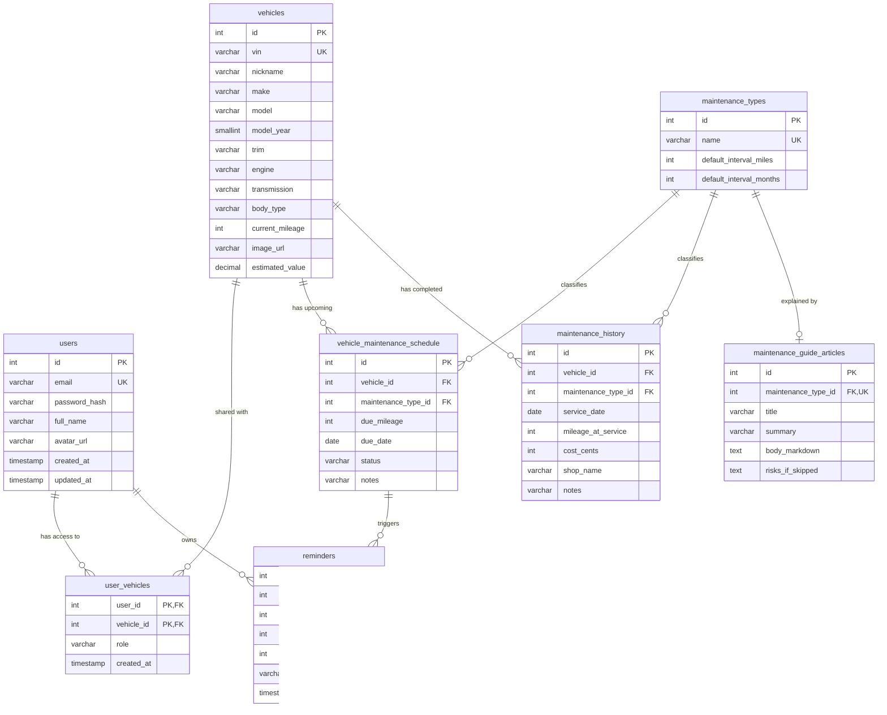

# RoadReady

RoadReady is a vehicle maintenance dashboard. Users create an account, add their vehicles, schedule upcoming maintenance, review service history, and read short guides on why each service matters.

**Stack:** Node.js + Express 5 (REST/JSON API, session cookies) · MySQL 8 (`mysql2`) · bcrypt password hashing (`bcryptjs`) · vanilla JavaScript front-end using `fetch()` + Bootstrap 5.

---

## 1. Project Overview

| Page | What it does | API used |
|---|---|---|
| Register / Login / Logout (`/forms/*`) | Account creation, sign-in, sign-out | `/api/auth/*` |
| Dashboard | Current vehicle, next service, yearly service count/cost, status, upcoming + recent maintenance | `GET /api/dashboard` |
| My Vehicle | Lists the user's vehicles, shows details and an estimated value, **imports vehicles from a CSV file** | `GET /api/vehicle`, `POST /api/vehicle/import`, `GET /api/vehicle/:id/value` |
| Maintenance | Per-vehicle schedule and history; **add, complete, and delete scheduled items** | `GET/POST/PATCH/DELETE /api/maintenance` |
| Reminders | Due-soon / overdue view of the scheduled maintenance for a vehicle | `GET /api/maintenance` |
| Maintenance Guide | Articles loaded from the database | `GET /api/maintenance-guide` |
| Profile | Shows account info, **changes password** | `GET /api/auth/me`, `POST /api/auth/change-password` |

Pages other than login/register require an authenticated session. Unauthenticated page requests are redirected to the login page; unauthenticated API requests receive `401` JSON.

---

## 2. Setup Instructions

### Prerequisites
- Node.js 18 or newer (tested on Node 22)
- MySQL 8+ (or MariaDB 10.5+, e.g. XAMPP)

### Steps

1. **Clone and install dependencies**
   ```bash
   git clone https://github.com/Etown-CS310/RoadReady.git
   cd RoadReady
   npm install
   ```

2. **Create the database** (MySQL shell or phpMyAdmin)
   ```sql
   CREATE DATABASE roadready;
   ```

3. **Load the schema and sample data**
   ```bash
   mysql -u <your_user> -p roadready < roadready_database.sql
   ```
   (Or paste/import `roadready_database.sql` in phpMyAdmin with the `roadready` database selected.) The script creates all tables and views and is safe to re-run.

4. **Configure environment variables** – copy the template and fill it in:
   ```bash
   cp .env.example .env
   ```

   | Variable | Required | Description |
   |---|---|---|
   | `DB_HOST` | yes | Database host, e.g. `localhost` |
   | `DB_PORT` | yes | Database port, usually `3306` |
   | `DB_USER` | yes | Database user |
   | `DB_PASSWORD` | yes | Database password (blank is fine for default XAMPP root) |
   | `DB_NAME` | yes | `roadready` |
   | `PORT` | no | Web server port (default `3000`) |
   | `SESSION_SECRET` | recommended | Long random string used to sign session cookies |
   | `AUTODEV_API_KEY` | no | Auto.dev key for the "Estimated Value" card; without it that card shows "Unavailable" |

   `.env` is git-ignored. **Never commit it.**

5. **Run the app**
   ```bash
   npm start        # node server/server.js
   # or, for auto-reload during development:
   npm run dev      # nodemon server/server.js
   ```

6. Open **http://localhost:3000** (or your `PORT`) → you will be sent to the login page.

7. **Try it out:** click *Register* and create an account. A new account has no vehicles, so go to **My Vehicle → Import CSV** and upload the included `sample-vehicles.csv` (required columns: `make`, `model`, `model_year`, `current_mileage`; optional: `vin`, `nickname`, `trim`, `engine`, `transmission`, `body_type`, `image_url`). Then use the Maintenance page to add schedule items.

   > The sample users in the SQL file use placeholder password hashes, so they cannot log in. They exist only as test rows; register a real account instead.

Quick connectivity check: `GET /api/test-db` returns `{"success":true,"message":"Connected to MySQL",...}`.

---

## 3. Database Design

### ERD



### Tables

| Table | Purpose |
|---|---|
| `users` | Accounts. Stores a **bcrypt hash** in `password_hash` (never plaintext). `email` is unique. |
| `vehicles` | Vehicle details (VIN unique, make/model/year, mileage, cached `estimated_value`). |
| `user_vehicles` | Many-to-many link between users and vehicles (`role` = owner/family). Every vehicle/maintenance query is scoped through this table so users only see their own data. |
| `maintenance_types` | Catalog of service types (Oil Change, Tire Rotation, ...). New types are created when a user picks "Other". |
| `maintenance_guide_articles` | One guide article per maintenance type, shown on the Maintenance Guide page. |
| `vehicle_maintenance_schedule` | Upcoming/planned maintenance per vehicle (`status`: `good`, `soon`, `overdue`, `completed`). |
| `maintenance_history` | Completed services per vehicle (date, mileage, cost, shop). Marking a schedule item complete adds a row here. |
| `reminders` | Reserved for notification settings tied to schedule items (not yet used by the API; planned for the final version). |

Views used by the dashboard: `vehicle_next_service`, `vehicle_maintenance_this_year`, `vehicle_status`.

Foreign keys use `ON DELETE CASCADE` where child rows should disappear with their parent (e.g., deleting a vehicle removes its schedule and history).

---

## 4. API Documentation

All endpoints are JSON. Authentication uses a session cookie set by `POST /api/auth/login` (the front-end sends it with `credentials: "include"`). Every error response has the shape:

```json
{ "success": false, "message": "Human-readable explanation." }
```

### Status codes used

| Code | Meaning in this app |
|---|---|
| 200 OK | Successful read/update/delete/login |
| 201 Created | Resource created (register, add maintenance, import vehicles) |
| 400 Bad Request | Missing/invalid field, malformed JSON |
| 401 Unauthorized | Not logged in, wrong credentials, wrong current password |
| 403 Forbidden | Logged in but the vehicle is not yours (`POST /api/maintenance/:vehicleId`) |
| 404 Not Found | Record doesn't exist or isn't yours; unknown `/api/...` route |
| 409 Conflict | Duplicate email or duplicate VIN |
| 500 Internal Server Error | Unexpected server/database error |

### Authentication

#### `POST /api/auth/register`
Create an account. Validates required fields, email format, password length (8–72 bytes), and rejects duplicate emails. Password is hashed with bcrypt before storage.

Body:
```json
{ "fullName": "Test User", "email": "t@example.com", "password": "password123" }
```
Response `201`:
```json
{ "success": true, "message": "Account created successfully.", "userId": 6 }
```
Errors: `400` (missing/invalid field, short password), `409` (email already registered), `500`.

#### `POST /api/auth/login`
Verify credentials and start a session.

Body: `{ "email": "t@example.com", "password": "password123" }`

Response `200`:
```json
{ "success": true, "user": { "id": 6, "email": "t@example.com", "fullName": "Test User", "avatarUrl": null } }
```
Errors: `400` (missing fields), `401` (`"Invalid email or password."`), `500`.

#### `POST /api/auth/logout`
Destroys the session. Response `200`: `{ "success": true }`. Error: `500`.

#### `GET /api/auth/me`
Returns the logged-in user. `200`: `{ "success": true, "user": { ... } }`. `401`: `{ "success": false, "user": null }`.

#### `POST /api/auth/change-password` 🔒
Body: `{ "currentPassword": "...", "newPassword": "..." }`
Response `200`: `{ "success": true, "message": "Password updated successfully." }`
Errors: `400` (invalid/same password), `401` (not logged in or current password wrong), `404`, `500`.

### Vehicles

#### `GET /api/vehicle` 🔒
Returns the user's vehicles (read from DB).
```json
{
  "success": true,
  "user": { "id": 6, "email": "t@example.com", "fullName": "Test User", "avatarUrl": null },
  "vehicles": [
    { "id": 6, "vin": "1HGCM82633A004352", "nickname": null, "make": "Honda", "model": "Accord",
      "model_year": 2018, "trim": null, "engine": null, "transmission": null, "body_type": null,
      "current_mileage": 61200, "image_url": null, "role": "owner" }
  ]
}
```
Status: `200`, `401`, `500`.

#### `POST /api/vehicle/import` 🔒
Create vehicles from parsed CSV rows (all-or-nothing database transaction; each vehicle is linked to the user as `owner`). Max 500 rows.

Body:
```json
{ "vehicles": [ { "make": "Honda", "model": "Accord", "model_year": "2018", "current_mileage": "61,200", "vin": "1HGCM82633A004352" } ] }
```
Response `201`: `{ "success": true, "message": "1 vehicles imported successfully.", "imported": 1 }`
Errors: `400` (empty list, >500 rows, missing make/model, bad year/mileage, duplicate VINs inside the file), `401`, `409` (`"One or more VINs already exist in the database."`), `500`.

#### `GET /api/vehicle/:id/value` 🔒
Estimated value for one of the user's vehicles. Uses the stored `estimated_value`; if empty, fetches an average from Auto.dev (needs `AUTODEV_API_KEY`) and caches it in the database.
```json
{ "success": true, "value": 18500, "low": 17020, "high": 19980, "updated": "2026-11-11", "source": "Database" }
```
Status: `200`, `401`, `404` (vehicle not yours / no valuation data), `500` (e.g., API key missing).

### Maintenance

#### `GET /api/maintenance` 🔒
Returns the user's vehicles, open schedule items, and service history.
```json
{
  "success": true,
  "user": { "id": 6, "email": "t@example.com", "fullName": "Test User", "avatarUrl": null },
  "vehicles": [ { "id": 6, "make": "Honda", "model": "Accord", "model_year": 2018, "current_mileage": 61200 } ],
  "maintenance": [
    { "id": 10, "vehicle_id": 6, "maintenance_type_id": 1, "due_mileage": 65000,
      "due_date": "2026-12-01", "status": "good", "notes": "synthetic", "maintenance_name": "Oil Change" }
  ],
  "history": []
}
```
Status: `200`, `401`, `500`.

#### `POST /api/maintenance/:vehicleId` 🔒
Add a scheduled item. Body:
```json
{ "maintenanceType": "Oil Change", "dueMileage": 65000, "dueDate": "2026-12-01", "notes": "synthetic" }
```
- `maintenanceType` required (string ≤ 100). If it is `"Other"`, `customMaintenanceType` is required and becomes a new maintenance type.
- `dueMileage` optional non-negative integer; `dueDate` optional real `YYYY-MM-DD` date; `notes` optional ≤ 255 chars.

Response `201`:
```json
{ "success": true, "maintenance": { "id": 10, "vehicle_id": 6, "maintenance_type_id": 1,
  "maintenance_name": "Oil Change", "due_mileage": 65000, "due_date": "2026-12-01", "status": "good", "notes": "synthetic" } }
```
Errors: `400` (invalid ID/field), `401`, `403` (not your vehicle), `500`.

#### `PATCH /api/maintenance/:id` 🔒
Update a scheduled item. Body may contain any of `status` (`good|soon|overdue|completed`), `dueMileage`, `dueDate`, `notes` (use `null` to clear). Setting `status` to `completed` also inserts a row in `maintenance_history` (today's date, vehicle's current mileage) in the same transaction.

Response `200`: `{ "success": true, "maintenance": { ...updated item... } }`
Errors: `400` (invalid ID/field, or no fields supplied), `401`, `404` (not found or not yours), `500`.

#### `DELETE /api/maintenance/:id` 🔒
Delete a scheduled item. Response `200`: `{ "success": true, "message": "Maintenance item deleted." }`
Errors: `400`, `401`, `404`, `500`.

### Dashboard & Guide

#### `GET /api/dashboard` 🔒
Returns the user's first vehicle plus `nextService`, `maintenanceThisYear` (`services_completed`, `total_cost_cents`), `vehicleStatus`, `upcomingMaintenance` (≤5) and `history` (≤5). If the user has no vehicle, `vehicle` is `null` and the lists are empty. Status: `200`, `401`, `500`.

#### `GET /api/maintenance-guide` 🔒
Returns `{ "success": true, "user": {...}, "guides": [ { "id", "maintenance_type_id", "category", "title", "summary", "body_markdown", "risks_if_skipped", "updated_at" } ] }`. Status: `200`, `401`, `500`.

### Utility

#### `GET /api/test-db`
Runs `SELECT 1` to confirm database connectivity. `200` on success, `500` if the database is unreachable.

🔒 = requires a logged-in session.

### Testing with curl

```bash
# register, log in (saves cookie), then call a protected endpoint
curl -X POST localhost:3000/api/auth/register -H "Content-Type: application/json" \
  -d '{"fullName":"Test User","email":"t@example.com","password":"password123"}'
curl -c cookies.txt -X POST localhost:3000/api/auth/login -H "Content-Type: application/json" \
  -d '{"email":"t@example.com","password":"password123"}'
curl -b cookies.txt localhost:3000/api/vehicle
# error example: no cookie -> 401
curl -i localhost:3000/api/maintenance
```

---

## 5. Project Structure

```
server/
  server.js              Express app, sessions, page protection, static files
  db.js                  MySQL connection pool (settings from .env)
  middleware/auth.js     requireLogin / requirePageLogin
  routes/                auth, dashboard, maintenance, maintenance-guide, vehicle
client/
  components/            shared navbar + footer
  css/styles.css
  js/                    app.js (shared), reminders.js, auth/*, pages/*
web/                     protected pages (dashboard, maintenance, vehicle, reminders, guide)
forms/                   login, register, logout, profile
roadready_database.sql   schema, views, sample data
sample-vehicles.csv      example file for the CSV import
.env.example             environment variable template
```

---

## 6. Known Limitations / Planned Work

- Custom reminders and "completed" flags on the **Reminders** page are stored in the browser (`localStorage`), not the database. Moving them to the `reminders` table through the API is planned for the final version. (Scheduled items can already be completed/deleted in the database from the **Maintenance** page.)
- There is no UI yet for logging a past service directly into `maintenance_history` or for editing a vehicle's mileage.
- Estimated value requires an Auto.dev API key.
- Sessions use the default in-memory store, so users are signed out when the server restarts.

---

## 7. Team Contributions (Milestone 2)

| Team member | Contributions |
|---|---|
| Sam Vossen | Auth APIs, bcrypt hashing, session middleware, database schema |
| Connor Price | Maintenance API, CSV import, vehicle value card, Vehicle API |
| Giuseppe La Face | Reminders page, Dark Mode Button, Car Photo Carousel, ERD |
